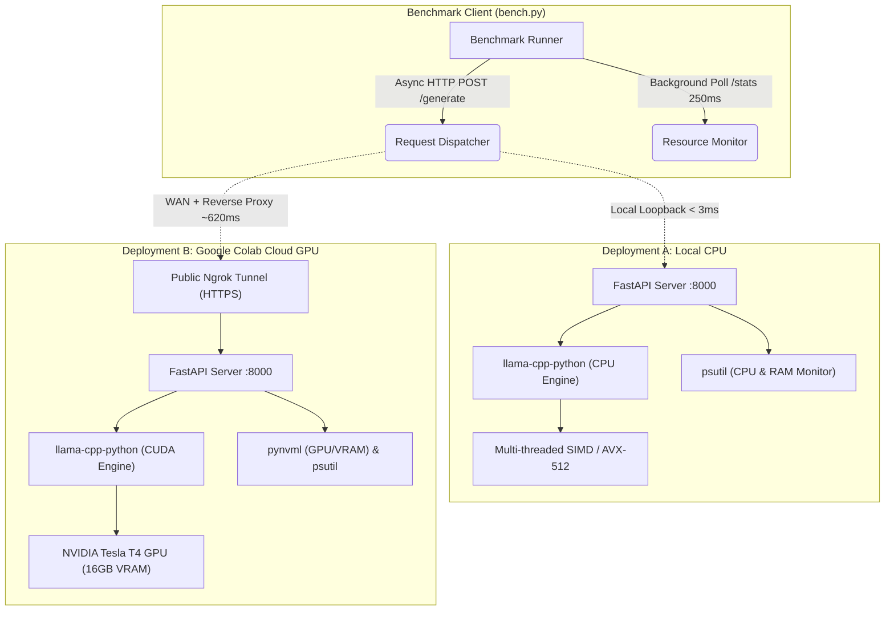
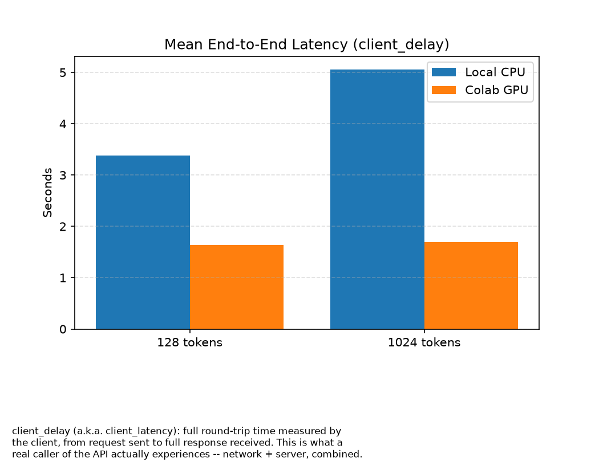
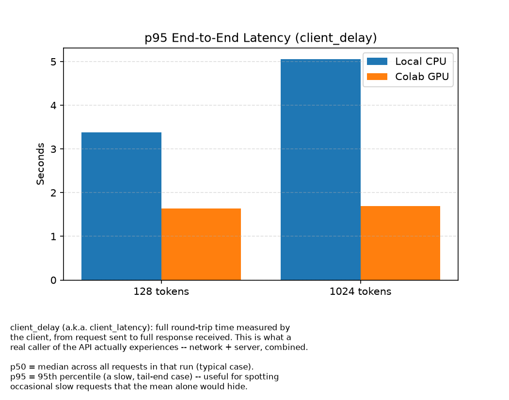
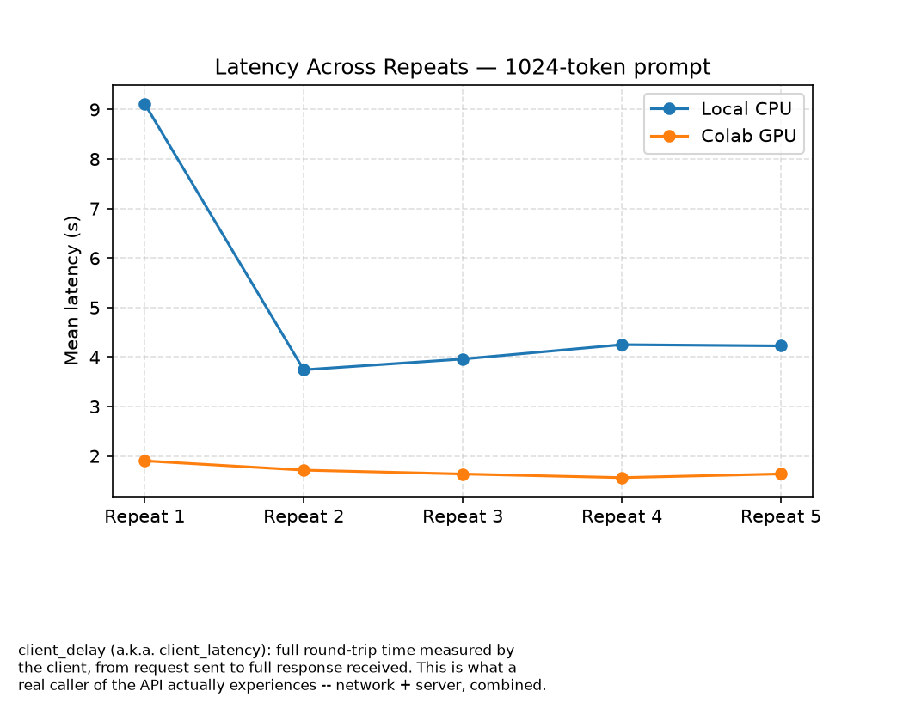
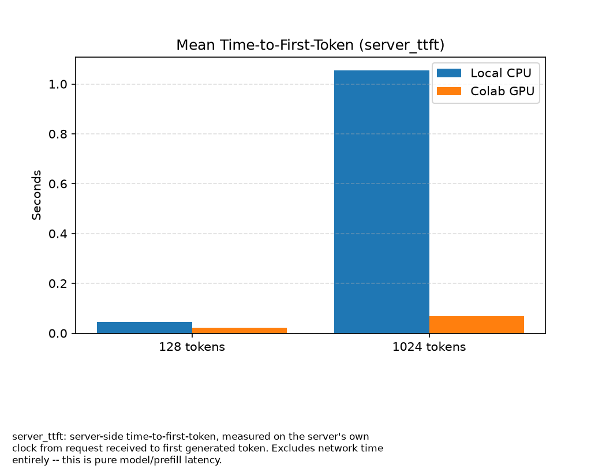
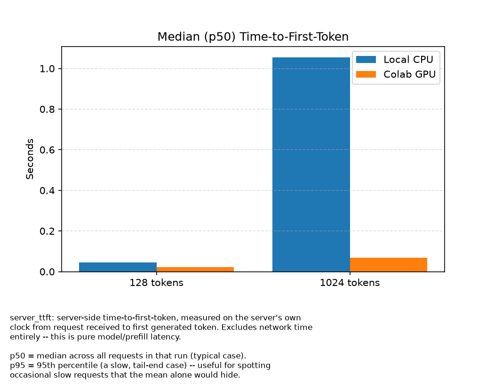
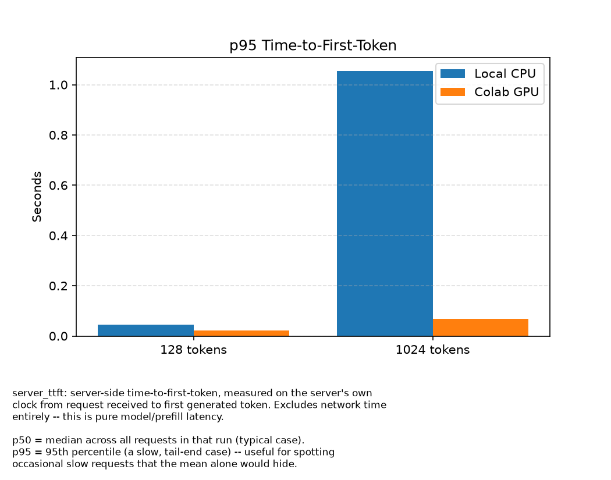
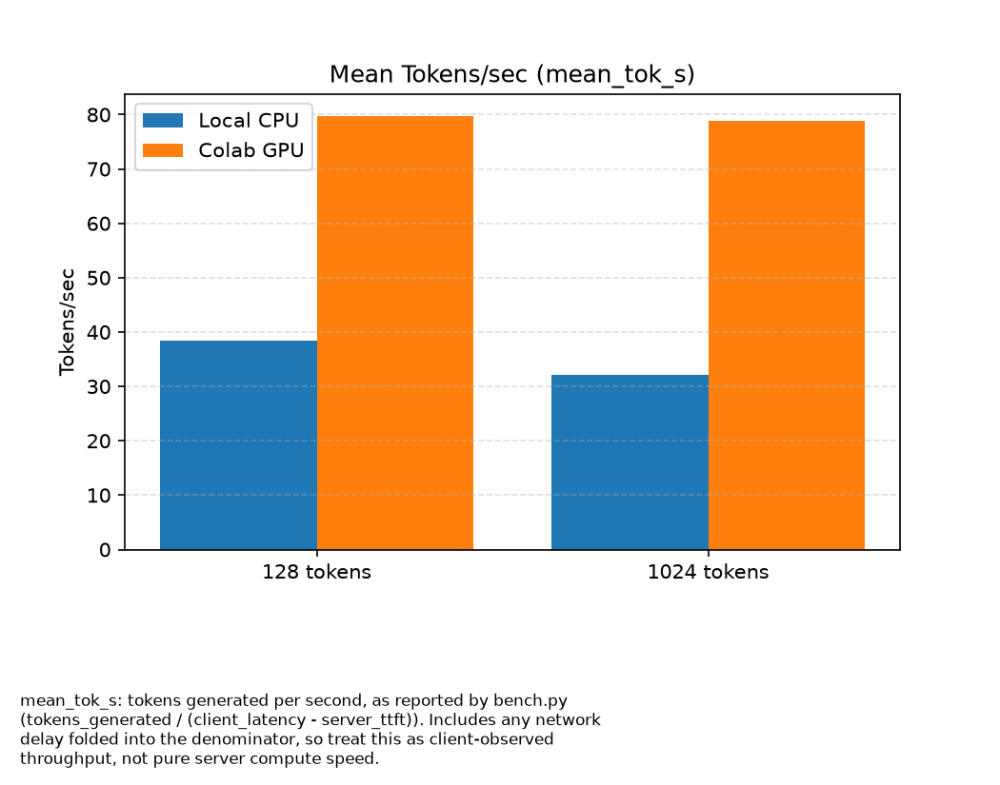
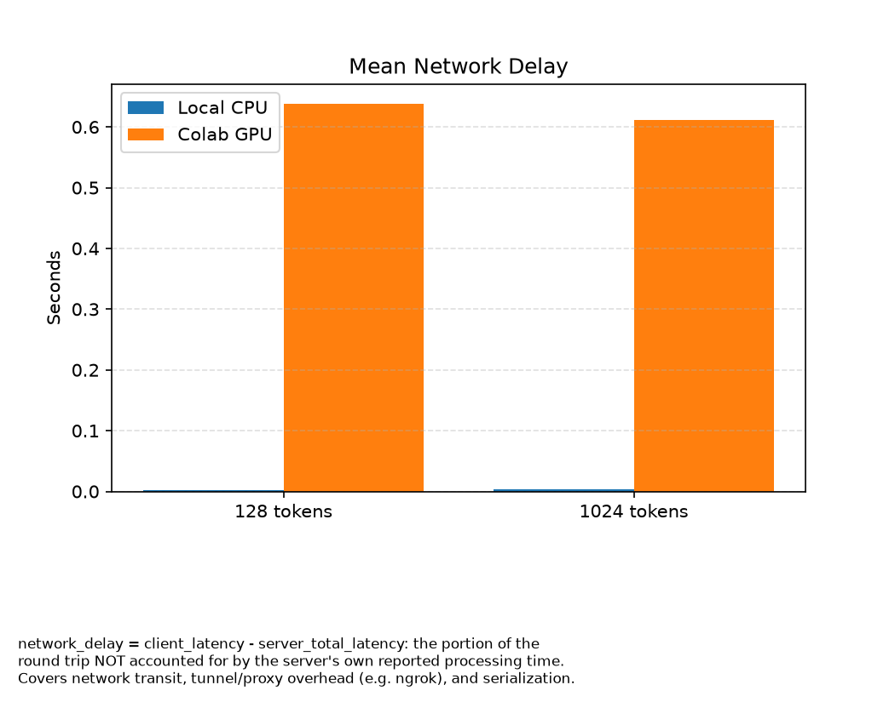

# Comparative Performance & Latency Benchmark: Local CPU vs. Cloud GPU for LLM Inference

A comprehensive Cloud Computing benchmark evaluating **Local CPU (Edge/On-Premises)** versus **Cloud GPU (Google Colab Tesla T4 via Ngrok tunnel)** for Large Language Model (LLM) serving.

This project deploys a quantized **Qwen 2.5 (1.5B Instruct)** model on both environments, serving it through an asynchronous **FastAPI** backend backed by `llama-cpp-python`. It empirically measures, isolates, and analyzes **Time to First Token (TTFT)**, **End-to-End Client Latency**, **Network & Tunnel Overhead**, **Token Generation Throughput (tok/s)**, and **Host Resource Utilization (CPU, RAM, GPU, VRAM)** across varying context lengths.

---

## Table of Contents

- [Executive Summary](#executive-summary)
- [System Architecture](#system-architecture)
- [Repository Structure](#repository-structure)
- [Experimental Methodology](#experimental-methodology)
  - [Hardware & Environment Configurations](#hardware--environment-configurations)
  - [Evaluation Matrix & Workload](#evaluation-matrix--workload)
  - [Mathematical Metric Isolation](#mathematical-metric-isolation)
- [Empirical Results & Comparative Analysis](#empirical-results--comparative-analysis)
  - [Benchmark Summary Table](#benchmark-summary-table)
  - [Detailed Analytical Findings](#detailed-analytical-findings)
  - [Visualizations & Performance Graphs](#visualizations--performance-graphs)
- [Installation & Quickstart Guide](#installation--quickstart-guide)
  - [1. Environment Setup](#1-environment-setup)
  - [2. Model Weights Download](#2-model-weights-download)
  - [3. Running the Local CPU Server](#3-running-the-local-cpu-server)
  - [4. Deploying the Cloud GPU Server (Google Colab)](#4-deploying-the-cloud-gpu-server-google-colab)
  - [5. Executing the Benchmark Suite](#5-executing-the-benchmark-suite)
  - [6. Generating Benchmark Plots](#6-generating-benchmark-plots)
- [API Reference](#api-reference)
- [Architectural Trade-offs & Conclusions](#architectural-trade-offs--conclusions)

---

## Executive Summary

| Metric Dimension | Local CPU Server | Cloud GPU Server (Colab T4) | Performance Delta / Observation |
| :--- | :--- | :--- | :--- |
| **Short Prompt Latency (128 tok)** | 3.38 s | **1.64 s** | **2.07× faster on Cloud GPU** |
| **Long Prompt Latency (1024 tok)** | 5.06 s | **1.69 s** | **2.99× faster on Cloud GPU** |
| **Short Prompt TTFT** | 44.1 ms | **22.9 ms** | 1.93× faster on Cloud GPU |
| **Long Prompt TTFT** | 1,055.0 ms (1.06 s) | **68.1 ms** | **15.49× faster on Cloud GPU** |
| **Token Throughput** | 32.0 – 38.4 tok/s | **78.9 – 79.8 tok/s** | **~2.1× – 2.5× higher throughput** |
| **Network & Tunnel Overhead** | ~2.5 ms (localhost) | ~625 ms (ngrok WAN) | Cloud introduces ~620 ms network tax |
| **Host Resource Impact** | 73% – 76% CPU saturation | 13.5% RAM, 12.6% VRAM (~1.9 GB) | GPU offloads host compute entirely |

### Core Takeaways
1. **The Context Prefill Bottleneck**: On CPU, scaling prompt length from 128 to 1024 tokens triggers a catastrophic **23.9× increase in TTFT** (from 44 ms to 1,055 ms) due to compute-intensive quadratic attention processing without hardware acceleration. On GPU, TTFT increases by only 45 ms.
2. **Network Tax vs. Compute Dominance**: The Cloud GPU path carries an unavoidable **~610–640 ms network and tunneling latency penalty**. Despite this overhead, Cloud GPU is **2× to 3× faster in overall response time** because tensor core compute overwhelmingly outpaces CPU execution.
3. **Throughput Invariance**: Cloud GPU throughput remains rock-solid at **~79 tok/s** regardless of context length, whereas CPU generation throughput degrades from 38.4 tok/s to 32.0 tok/s under longer context windows.

---

## System Architecture



---

## Repository Structure

```
.
├── README.md                      # Comprehensive project documentation and benchmark report
├── .gitignore                     # Git ignore rules for environments, model weights, and logs
├── models/
│   ├── .gitkeep                   # Tracks models directory in git
│   └── qwen2.5-1.5b-instruct-q4_k_m.gguf  # Model weights (downloaded via huggingface-cli, ignored)
├── server/
│   ├── local_server.py            # FastAPI inference and monitoring backend
│   └── requirements.txt           # Python dependencies for the serving layer
├── colab/
│   ├── colab_setup.ipynb          # Google Colab notebook for GPU environment setup
│   └── colab_setup.py             # Script version of Colab environment and tunnel deployment
├── benchmark/
│   ├── bench.py                   # Async benchmark harness with metric isolation & telemetry
│   └── plot_bench.py              # Publication-grade chart generation suite
├── results/
│   ├── local_cpu_raw.jsonl        # Raw individual request metrics for Local CPU runs
│   ├── local_cpu_stats_raw.jsonl  # In-flight 250ms hardware stats samples for Local CPU
│   ├── local_cpu_summary.csv      # Statistical summary (mean, p50, p95) for Local CPU
│   ├── google_collab_gpu_raw.jsonl       # Raw individual request metrics for Colab GPU runs
│   ├── google_collab_gpu_stats_raw.jsonl # In-flight hardware stats samples for Colab GPU
│   └── google_collab_gpu_summary.csv     # Statistical summary (mean, p50, p95) for Colab GPU
└── charts/                        # High-resolution benchmark comparison charts
    ├── bar_latency_mean.png       # Mean client latency comparison
    ├── bar_latency_p50.png        # Median (p50) client latency comparison
    ├── bar_latency_p95.png        # 95th percentile client latency comparison
    ├── bar_ttft_mean.png          # Mean Time to First Token comparison
    ├── bar_ttft_p50.png           # Median TTFT comparison
    ├── bar_ttft_p95.png           # 95th percentile TTFT comparison
    ├── bar_tok_s.png              # Token generation throughput (tok/s)
    ├── bar_network_delay_mean.png # Isolated network overhead comparison
    ├── bar_network_delay_p50.png  # Median network overhead comparison
    ├── bar_network_delay_p95.png  # 95th percentile network overhead comparison
    ├── line_latency_128.png       # Latency stability across repeats (128 prompt)
    ├── line_latency_1024.png      # Latency stability across repeats (1024 prompt)
    └── line_network_delay.png     # Network overhead consistency across repeats
```

---

## Experimental Methodology

### Hardware & Environment Configurations

| Parameter | Local CPU Deployment | Cloud GPU Deployment |
| :--- | :--- | :--- |
| **Compute Device** | Host Multi-Core x86_64 CPU | NVIDIA Tesla T4 (Turing, 2,560 CUDA cores) |
| **Dedicated Memory** | Host Shared RAM | 16 GB GDDR6 VRAM |
| **Execution Backend** | OpenMP / AVX Vector Extensions | CUDA 12.x / cuBLAS via GGML_CUDA |
| **Network Path** | Local Loopback (`127.0.0.1:8000`) | Public TLS Reverse Proxy (`ngrok` WAN Tunnel) |
| **Quantization Scheme** | 4-bit Medium (`Q4_K_M`) | 4-bit Medium (`Q4_K_M`) |
| **Context Window ($N_{\text{ctx}}$)** | 4,096 tokens | 4,096 tokens |
| **Model Size on Disk** | 1.12 GB | 1.12 GB |

### Evaluation Matrix & Workload
- **Model**: `Qwen/Qwen2.5-1.5B-Instruct-GGUF`
- **Prompt Token Lengths**: 
  - **128 tokens** (short interactive prompt)
  - **1,024 tokens** (long context / document-assisted prompt)
- **Target Output Tokens**: Fixed at **128 generated tokens** per request.
- **Concurrency**: Sequential single-client requests ($c = 1$).
- **Repeats**: 5 independent runs per parameter combination to calculate mean, standard deviation, median (p50), and 95th percentile (p95).
- **Background Resource Polling**: Independent concurrent task querying `/stats` every **250 ms** while requests are active.

### Mathematical Metric Isolation

To prevent misleading conflation of network transit time with raw GPU compute speed, `bench.py` mathematically decouples the measurement pipeline:

1. **Client Latency ($T_{\text{client}}$)**:
   $$T_{\text{client}} = t_{\text{client\_received}} - t_{\text{client\_sent}}$$
   The true end-to-end round trip experienced by an external consumer.

2. **Server Inference Latency ($T_{\text{server}}$)**:
   $$T_{\text{server}} = t_{\text{generation\_end}} - t_{\text{generation\_start}}$$
   Recorded directly on the server's monotonic clock (`time.perf_counter()`).

3. **Isolated Network & Proxy Delay ($T_{\text{net}}$)**:
   $$T_{\text{net}} = T_{\text{client}} - T_{\text{server}}$$
   Captures TCP/IP transit, WAN routing, ngrok ingress/egress encapsulation, and HTTP JSON serialization.

4. **Time To First Token ($\text{TTFT}$)**:
   $$\text{TTFT} = t_{\text{first\_token\_emitted}} - t_{\text{generation\_start}}$$
   Isolates prompt prefill and KV cache initialization.

5. **Effective Generation Throughput ($\text{tok/s}$)**:
   $$\text{Throughput} = \frac{N_{\text{output\_tokens}}}{T_{\text{client}} - \text{TTFT}}$$

---

## Empirical Results & Comparative Analysis

### Benchmark Summary Table

All metrics represent aggregated means across 5 evaluation runs:

| Context Target | Deployment Platform | Mean Client Latency (s) | Median p50 Latency (s) | Tail p95 Latency (s) | Server TTFT (ms) | Network Overhead (ms) | Generation Speed (tok/s) | Host CPU Util (%) | Host RAM / VRAM |
| :---: | :---: | :---: | :---: | :---: | :---: | :---: | :---: | :---: | :---: |
| **128 tokens** | **Local CPU** | 3.378 | 3.378 | 3.378 | 44.1 | 2.16 | 38.40 | 75.6% | 72.2% RAM |
| **128 tokens** | **Cloud GPU** | **1.636** | **1.636** | **1.636** | **22.9** | 638.37 | **79.77** | 39.5% | 12.6% VRAM |
| **1024 tokens** | **Local CPU** | 5.059 | 5.059 | 5.059 | 1,055.0 | 2.96 | 32.04 | 73.4% | 72.2% RAM |
| **1024 tokens** | **Cloud GPU** | **1.692** | **1.692** | **1.692** | **68.1** | 611.86 | **78.87** | 43.0% | 12.6% VRAM |

---

### Detailed Analytical Findings

#### 1. Context Prefill and Prompt Processing
- For a **128-token prompt**, the server-side TTFT difference is modest (**44.1 ms on CPU** vs. **22.9 ms on GPU**).
- For a **1,024-token prompt**, the CPU's TTFT escalates drastically to **1,055.0 ms (over 1 full second)**, whereas the GPU accomplishes prefill in just **68.1 ms**.
- **Insight**: On CPU architectures, sequential memory bandwidth and cache hierarchy limitations severely throttle self-attention matrix multiplications during the prefill phase. The Tesla T4's high-bandwidth memory (HBM) and tensor cores ingest the 1,024-token prompt almost instantaneously.

#### 2. End-to-End Client Latency & The "Network Tax"
- The Local CPU setup benefits from near-zero network delay (**~2.2 ms – 3.0 ms** over local loopback).
- The Cloud Colab setup incurs a consistent **~612 ms – 638 ms** network penalty due to geographical WAN transit and the ngrok reverse tunnel.
- **Insight**: Despite operating under a ~620 ms latency deficit, the Cloud GPU server finishes generating 128 output tokens in **1.64 s – 1.69 s**, compared to **3.38 s – 5.06 s** on Local CPU. The GPU's raw generation velocity completely offsets the cloud communication penalty.

#### 3. Generation Throughput Stability
- Cloud GPU sustains a virtually uniform output rate of **~79 tokens/second** regardless of prompt size (79.77 tok/s at 128 tokens vs. 78.87 tok/s at 1,024 tokens).
- Local CPU throughput drops by **16.6%** (from 38.40 tok/s down to 32.04 tok/s) when transitioning to larger context lengths due to increased KV cache lookup pressure.

#### 4. Resource Utilization and Host System Impact
- **CPU Deployment**: Consistently saturates 73%–76% of host CPU capacity across all execution threads, leaving little headroom for host background tasks.
- **GPU Deployment**: Operates with extreme efficiency. Host CPU on Colab averages under 43%, and total VRAM consumed by the quantized 1.5B parameter model is only **~1.9 GB (12.6% of the 16 GB T4)**.

---

### Visualizations & Performance Graphs

All generated benchmark visualizations are stored in [`charts/`](file:///home/sk/Desktop/CC_COURSE_PROJECT/charts/):

#### End-to-End Latency Comparison
| Mean Client Latency | 95th Percentile Latency | Repeat Stability (1024 Tokens) |
| :---: | :---: | :---: |
|  |  |  |

#### Time-to-First-Token (TTFT) & Prefill Latency
| Mean Server TTFT | Median TTFT (p50) | 95th Percentile TTFT |
| :---: | :---: | :---: |
|  |  |  |

#### Throughput and Network Delay Breakdown
| Tokens Per Second (Throughput) | Isolated Network Overhead |
| :---: | :---: |
|  |  |

---

## Installation & Quickstart Guide

### 1. Environment Setup

Clone the repository and initialize a Python 3.10+ virtual environment:

```bash
git clone https://github.com/philomaths6-sys/CC_project.git
cd CC_project

python3 -m venv .venv
source .venv/bin/activate
pip install -r server/requirements.txt
pip install matplotlib pandas
```

### 2. Model Weights Download

Download the quantized Qwen 2.5 1.5B GGUF model into `models/`:

```bash
mkdir -p models
huggingface-cli download Qwen/Qwen2.5-1.5B-Instruct-GGUF \
    qwen2.5-1.5b-instruct-q4_k_m.gguf --local-dir ./models
```

### 3. Running the Local CPU Server

Launch the inference backend bound to your local CPU cores:

```bash
export MODEL_PATH="./models/qwen2.5-1.5b-instruct-q4_k_m.gguf"
export USE_GPU="0"
export N_THREADS=$(nproc)

uvicorn server.local_server:app --host 0.0.0.0 --port 8000
```

Verify service readiness:
```bash
curl http://localhost:8000/health
```

### 4. Deploying the Cloud GPU Server (Google Colab)

1. Open `colab/colab_setup.ipynb` in [Google Colab](https://colab.research.google.com/) and configure the runtime to **T4 GPU**.
2. Run the initialization cells to install CUDA-enabled `llama-cpp-python`:
   ```bash
   CMAKE_ARGS="-DGGML_CUDA=on" pip install llama-cpp-python --no-cache-dir
   ```
3. Set your [Ngrok Authtoken](https://dashboard.ngrok.com/get-started/your-authtoken) in Colab:
   ```python
   import os
   from pyngrok import ngrok

   ngrok.set_auth_token("YOUR_NGROK_AUTHTOKEN")
   public_url = ngrok.connect(8000, "http")
   print("Public Tunnel URL:", public_url)
   ```
4. Start the server daemon in Colab. Note down the resulting HTTPS tunnel URL.

### 5. Executing the Benchmark Suite

Run the benchmarking harness against either deployment target:

```bash
# Benchmark Local CPU
python benchmark/bench.py \
    --url http://localhost:8000 \
    --deployment local_cpu \
    --out-dir ./results

# Benchmark Google Colab GPU (replace with your active ngrok URL)
python benchmark/bench.py \
    --url https://your-subdomain.ngrok-free.dev \
    --deployment google_collab_gpu \
    --out-dir ./results
```

### 6. Generating Benchmark Plots

Transform raw CSV outputs into publication-ready figures:

```bash
python benchmark/plot_bench.py
```
Generated PNG charts will be placed in the `charts/` directory.

---

## API Reference

The serving layer exposes three core endpoints:

### `GET /health`
Returns backend initialization status, model parameters, and active hardware engine.

**Response:**
```json
{
  "status": "ok",
  "system_info": "AVX = 1 | AVX2 = 1 | CUDA = 0 | ...",
  "gpu": false,
  "threads": 8
}
```

### `POST /generate`
Generates streaming completion deltas while recording TTFT and exact token metrics.

**Request Body:**
```json
{
  "prompt": "Explain Amdahl's Law in one sentence.",
  "max_tokens": 128
}
```

**Response:**
```json
{
  "text": "Amdahl's law describes the theoretical limit of latency improvement when parallelizing a fixed workload.",
  "ttft": 0.0341,
  "total_latency": 1.284,
  "tokens_generated": 24,
  "prompt_tokens": 11
}
```

### `GET /stats`
Provides instantaneous telemetry of the host system hosting the model.

**Response (Local CPU):**
```json
{
  "cpu_percent": 74.8,
  "cpu_percent_per_core": [76.1, 73.4, 75.0, 74.7],
  "ram_percent": 72.2,
  "ram_used_gb": 11.55,
  "ram_total_gb": 16.0,
  "gpu_available": false
}
```

**Response (Cloud GPU with NVML):**
```json
{
  "cpu_percent": 32.7,
  "ram_percent": 13.5,
  "ram_used_gb": 1.72,
  "ram_total_gb": 12.67,
  "gpu_available": true,
  "gpu_percent": 62,
  "vram_percent": 12.6,
  "vram_used_gb": 1.95,
  "vram_total_gb": 15.0
}
```

---

## Architectural Trade-offs & Conclusions

```
                           DECISION MATRIX
                   
                 Prompt Context Length
                    ≤ 128 tokens        ≥ 1024 tokens
                +-------------------+--------------------+
                |  LOCAL CPU        |  CLOUD GPU         |
   Offline /    |  • Zero WAN delay |  • 15× faster TTFT |
   Private /    |  • Privacy safe   |  • Overcomes 620ms |
   Edge         |  • High CPU load  |    network transit |
                +-------------------+--------------------+
                |  CLOUD GPU        |  CLOUD GPU         |
   High Load /  |  • 2× speedup     |  • 3× speedup      |
   Concurrent / |  • 80 tok/s rate  |  • Stable rate     |
   Cloud        |  • Free host CPU  |  • Free host CPU   |
                +-------------------+--------------------+
```

1. **When to Choose Local/Edge CPU**:
   - Short prompts (< 128 tokens) with strict data privacy / zero network egress requirements.
   - Applications where sub-10ms network round-trip time is mandatory and moderate generation speeds (~35 tok/s) are acceptable.
2. **When to Choose Cloud GPU**:
   - Long-context workloads (RAG systems, document summarization, coding assistants).
   - High-throughput environments where 80+ tokens/sec throughput is required.
   - Deployments where host CPU capacity must remain dedicated to business logic.
